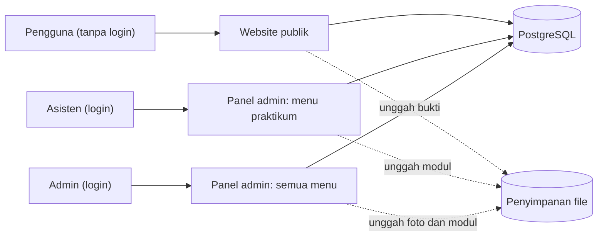
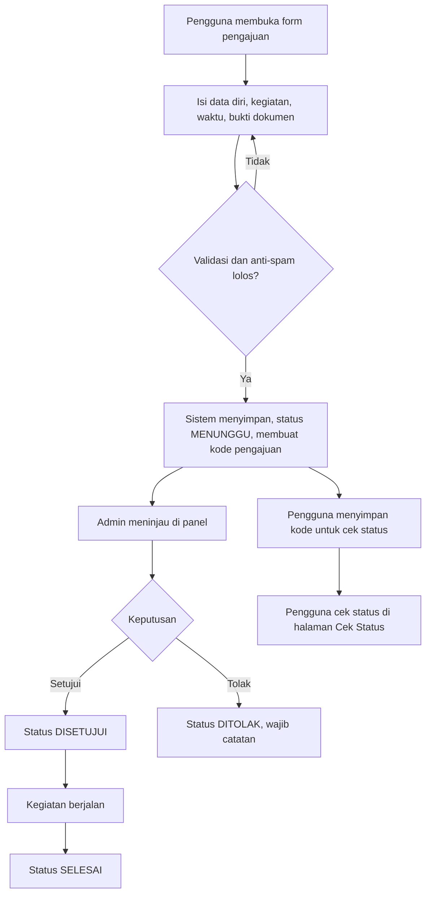
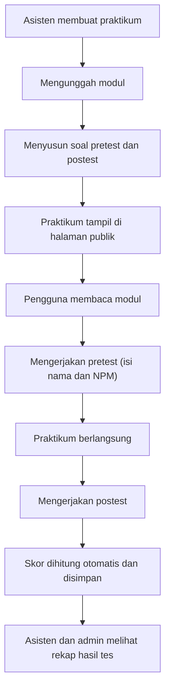
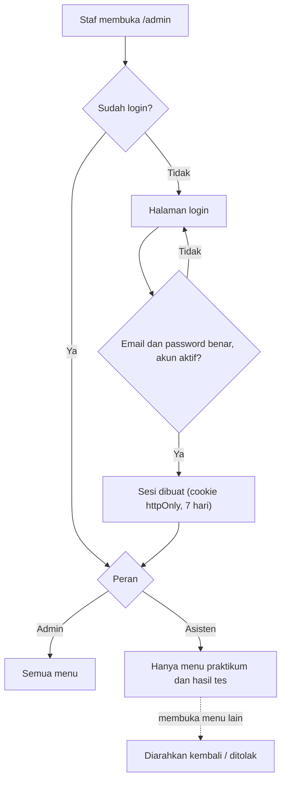

# Web Laboratorium Teknik Digital - Universitas Lampung

Website informatif dan layanan untuk Laboratorium Teknik Digital, Fakultas Teknik, Universitas Lampung. Pengunjung dapat melihat jadwal praktikum dan seminar, profil dan struktur lab, serta mengajukan peminjaman alat, ruangan, dan penelitian tanpa perlu login. Staf (asisten dan admin) mengelola konten lewat panel admin.

## Daftar Isi

1. [Pengguna dan Hak Akses](#pengguna-dan-hak-akses)
2. [Fitur](#fitur)
3. [Alur Kerja Sistem](#alur-kerja-sistem)
4. [Keterbatasan Sistem](#keterbatasan-sistem)
5. [Teknologi](#teknologi)
6. [Struktur Data](#struktur-data)
7. [Struktur Folder](#struktur-folder)
8. [Menjalankan Secara Lokal](#menjalankan-secara-lokal)
9. [Variabel Lingkungan](#variabel-lingkungan)
10. [Deploy](#deploy)
11. [Status Pengembangan](#status-pengembangan)

---

## Pengguna dan Hak Akses

Ada tiga jenis pengguna. Hanya asisten dan admin yang memiliki akun dan perlu login.

| Pengguna | Login | Hak akses |
|---|---|---|
| **Pengguna** (mahasiswa, dosen, pengunjung) | Tidak perlu | Melihat semua informasi lab, mengajukan peminjaman alat, ruangan, dan penelitian, mengecek status pengajuan, mengerjakan pretest dan postest, mengisi survei kepuasan |
| **Asisten** | Ya | Mengelola **praktikum saja**: modul, soal pretest, soal postest, dan melihat hasil tes. Tidak bisa membuka menu lain di panel admin. |
| **Admin** | Ya | **Kuasa penuh** atas seluruh sistem: semua yang bisa dilakukan asisten, ditambah jadwal, pengajuan, inventaris, anggota lab, pengumuman, survei, dokumentasi, pengaturan, dan akun staf |

### Matriks akses panel admin

| Menu | Admin | Asisten |
|---|:---:|:---:|
| Dashboard | ✅ | ✅ (ringkasan praktikum) |
| Praktikum (modul, pretest, postest) | ✅ | ✅ |
| Hasil tes | ✅ | ✅ |
| Jadwal | ✅ | ❌ |
| Pengajuan (setujui/tolak) | ✅ | ❌ |
| Inventaris (alat dan ruangan) | ✅ | ❌ |
| Anggota lab | ✅ | ❌ |
| Pengumuman | ✅ | ❌ |
| Survei | ✅ | ❌ |
| Dokumentasi | ✅ | ❌ |
| Pengaturan (visi, misi, kontak) | ✅ | ❌ |
| Akun staf | ✅ | ❌ |

> Hasil tes dimasukkan ke akses asisten karena merupakan bagian dari pretest dan postest. Jika ingin dibatasi hanya untuk admin, ubah di satu tempat (daftar menu per peran).

Penegakan hak akses dilakukan **di server** pada setiap halaman dan aksi (`wajibAdmin()` dan `wajibStaf()`), bukan hanya dengan menyembunyikan menu.

---

## Fitur

### Untuk pengguna (publik)

- **Beranda:** jam WIB, kegiatan berikutnya, agenda hari ini (otomatis dari data jadwal), pengumuman, kegiatan terbaru, pintasan layanan
- **Jadwal:** praktikum dan seminar per bulan, filter jenis dan ruangan, dikelompokkan per hari
- **Informasi lab:** profil (visi, misi, sejarah, fasilitas) dan struktur (kepala lab, PLP, asisten)
- **Pengajuan tanpa login:**
  - Peminjaman **alat** (pilih alat dan jumlah, tanggal pinjam dan kembali)
  - Peminjaman **ruangan** (ruangan, tanggal, jam mulai dan selesai)
  - **Penelitian** (judul, dosen pembimbing, abstrak, dapat sekaligus meminjam alat)
  - Bukti dokumen: unggah file (PDF/foto) atau tautan Google Drive
  - **Kode pengajuan** otomatis untuk **cek status** kapan saja
- **Praktikum:** daftar praktikum, unduh modul, kerjakan **pretest** dan **postest** (nilai otomatis, pilihan ganda)
- **Survei kepuasan anonim:** tanpa login dan tanpa menyimpan identitas
- **Dokumentasi:** galeri dan artikel kegiatan lab
- **Tema terang/gelap**, responsif untuk ponsel

### Untuk asisten

- Kelola praktikum: tambah, ubah, dan hapus praktikum
- Unggah dan kelola **modul** per praktikum
- Susun **soal pretest dan postest** per modul (pilihan ganda, kunci jawaban, durasi)
- Lihat dan rekap **hasil tes** peserta

### Untuk admin

Semua fitur asisten, ditambah:

- **Jadwal:** tambah, ubah, hapus, dengan **peringatan bentrok ruangan**
- **Pengajuan:** tinjau, setujui atau tolak dengan catatan, ubah status, cek bentrok jadwal dan ketersediaan stok alat
- **Inventaris:** kelola alat (stok, kondisi) dan ruangan
- **Anggota lab:** kelola kepala lab, PLP, dan asisten yang tampil di halaman Struktur
- **Pengumuman:** periode tayang, aktif/nonaktif
- **Survei:** kelola pertanyaan dan lihat rekap jawaban
- **Dokumentasi:** unggah foto dan tulis artikel kegiatan
- **Pengaturan:** visi, misi, sejarah, alamat, kontak, jam layanan
- **Akun staf:** tambah akun asisten atau admin, nonaktifkan akun, atur ulang password

---

## Alur Kerja Sistem

### 1. Gambaran umum



### 2. Alur pengajuan (alat, ruangan, penelitian)



Status pengajuan: `MENUNGGU` → `DISETUJUI` / `DITOLAK` → `SELESAI`. Pemohon juga dapat berstatus `DIBATALKAN`.

### 3. Alur praktikum, pretest, dan postest



### 4. Alur login dan pembatasan akses staf



### 5. Alur informasi harian

Beranda dan halaman jadwal membaca tabel `Jadwal` langsung. Saat admin menambahkan jadwal, kegiatan otomatis muncul di **Agenda Hari Ini** pada tanggal tersebut (batas hari dihitung menurut WIB), dan penanda **Berlangsung** muncul selama kegiatan berjalan.

---

## Keterbatasan Sistem

**Identitas pengguna tidak diverifikasi.** Karena pengajuan, pretest, dan postest tanpa login, nama dan NPM yang diisi tidak bisa dipastikan benar. Admin perlu memeriksa bukti dokumen sebelum menyetujui.

**Risiko spam.** Form publik dilindungi anti-spam (captcha dan pembatasan jumlah kiriman), tetapi tidak bisa sepenuhnya menutup penyalahgunaan.

**Hasil tes bukan ujian terawasi.** Peserta dapat mengerjakan berulang kali, mengisi NPM orang lain, atau membuka sumber lain. Nilai sebaiknya diperlakukan sebagai latihan, bukan penilaian resmi.

**Peran hanya dua untuk staf.** Admin dan asisten saja. Tidak ada peran terpisah untuk kepala lab atau PLP. Jabatan itu hanya tampil di halaman Struktur sebagai data, dan siapa pun yang memegang jabatan itu diberi akun admin atau asisten sesuai kebutuhan.

**Asisten tidak dibatasi per praktikum.** Asisten dapat mengelola semua praktikum, bukan hanya yang ia ampu.

**Tidak ada pendaftaran akun mandiri dan pemulihan password otomatis.** Akun staf dibuat oleh admin, dan password yang lupa direset oleh admin.

**Pemeriksaan bentrok terbatas.** Bentrok ruangan dicek terhadap data jadwal, dan stok alat terhadap pengajuan yang sudah disetujui. Pemakaian di luar sistem tidak terdeteksi.

**Notifikasi.** Tidak ada email atau pesan otomatis ke pemohon. Pemohon harus mengecek status sendiri dengan kode pengajuan. Notifikasi ke admin (email atau Telegram) bersifat opsional dan belum termasuk.

**Penyimpanan file terbatas.** Ukuran dan jenis file bukti dibatasi (PDF dan gambar). File besar disarankan lewat tautan Google Drive.

**Satu laboratorium.** Sistem dirancang untuk satu lab, bukan multi-lab.

**Di luar lingkup saat ini:** presensi (termasuk presensi wajah), kas, pameran, pembayaran, dan integrasi SSO kampus.

**Zona waktu.** Semua waktu ditampilkan dan diinput dalam WIB (UTC+7). Database menyimpan UTC.

---

## Teknologi

| Lapisan | Pilihan |
|---|---|
| Framework | Next.js 16 (App Router, Cache Components) |
| UI | React, Tailwind CSS v4, lucide-react |
| Backend | Server Actions dan Route Handlers Next.js |
| Database | PostgreSQL |
| ORM | Prisma 6 |
| Autentikasi | Sesi cookie JWT (`jose`) dan `bcryptjs` |
| Validasi | Zod |
| Deploy | Server kampus (Docker/PM2 + Nginx) atau Vercel + Neon |

---

## Struktur Data

Tabel utama (lihat `prisma/schema.prisma`):

- **Staff:** akun login dengan peran `ADMIN` atau `ASISTEN`
- **AnggotaLab:** data tampilan halaman Struktur (terpisah dari akun login)
- **Pengaturan, Pengumuman**
- **Ruangan, Alat:** inventaris
- **Jadwal:** praktikum, seminar, dan kegiatan lain
- **Pengajuan** dan **PengajuanAlat:** satu tabel untuk tiga jenis pengajuan
- **Praktikum, Modul, Tes, Soal, HasilTes**
- **Survei, PertanyaanSurvei, ResponSurvei, JawabanSurvei:** survei anonim
- **Dokumentasi, DokumentasiFoto**

---

## Struktur Folder

```
src/
├── app/
│   ├── (publik)/        # halaman publik (beranda, jadwal, pengajuan, praktikum, ...)
│   ├── admin/
│   │   ├── login/
│   │   └── (panel)/     # panel admin (dilindungi login dan peran)
│   └── api/upload/      # unggah file
├── components/          # ui, publik, admin
├── actions/             # Server Actions per fitur
└── lib/                 # prisma, auth, waktu, storage, validasi, kode
prisma/
├── schema.prisma
└── seed.ts
```

---

## Menjalankan Secara Lokal

Prasyarat: Node.js 20+, PostgreSQL.

```bash
# 1. pasang dependensi
npm install

# 2. salin dan isi variabel lingkungan
cp .env.example .env

# 3. buat database (sekali saja)
psql -U postgres -c "CREATE DATABASE lab_td;"

# 4. migrasi dan data awal
npx prisma migrate dev
npx tsx prisma/seed.ts

# 5. jalankan
npm run dev
```

Buka `http://localhost:3000`. Panel admin ada di `/admin`.

---

## Variabel Lingkungan

| Variabel | Fungsi |
|---|---|
| `DATABASE_URL` | Koneksi PostgreSQL |
| `AUTH_SECRET` | Kunci penanda sesi (string acak, minimal 32 karakter) |
| `ADMIN_EMAIL` | Email akun admin pertama (dipakai seed) |
| `ADMIN_PASSWORD` | Password admin pertama (dipakai seed) |

Jangan pernah meng-commit file `.env`. Gunakan `.env.example` sebagai contoh.

---

## Deploy

Target: subdomain di `eng.unila.ac.id`.

- **Server kampus:** jalankan Next.js dengan Docker atau PM2 di belakang Nginx, PostgreSQL di server yang sama, file upload di disk, HTTPS lewat Let's Encrypt.
- **Cloud:** Vercel untuk aplikasi dan Neon/Supabase untuk database, subdomain diarahkan lewat record CNAME dari admin DNS fakultas.

Sebelum produksi: ganti `AUTH_SECRET` dan password admin, pastikan `npm run build` bersih, dan atur cadangan database berkala.

---

## Status Pengembangan

| Tahap | Isi | Status |
|---|---|---|
| 1 | Skema database dan struktur folder | ✅ Selesai |
| 2 | Tema, layout publik, login staf, beranda | ✅ Selesai |
| 3 | Jadwal (publik dan admin), pengumuman | ✅ Selesai |
| 4 | Peran staf, inventaris, anggota lab, profil, struktur, pengaturan | 🔄 Berikutnya |
| 5 | Pengajuan (alat, ruangan, penelitian), cek status, persetujuan | ⏳ Direncanakan |
| 6 | Praktikum: modul, pretest, postest, hasil tes | ⏳ Direncanakan |
| 7 | Survei anonim dan dokumentasi | ⏳ Direncanakan |
| 8 | Akun staf, perapian, build bersih, deploy | ⏳ Direncanakan |

---

© Laboratorium Teknik Digital, Universitas Lampung.